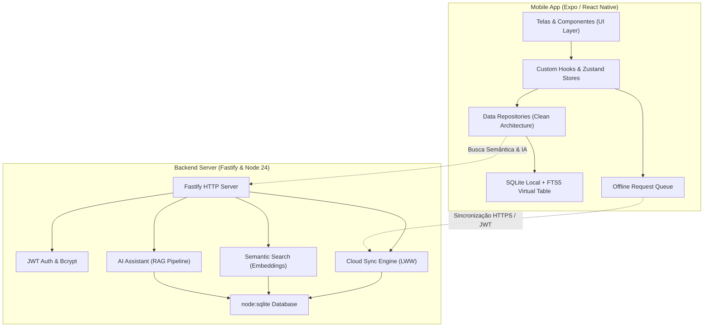

# 🏆 Bíblia Go — Portfólio & Demonstração Técnica

> **Projeto de Portfólio de Engenharia de Software**  
> Focado em Arquitetura Limpa, Manipulação de Dados, Engenharia Offline-First e APIs de Alta Performance.  
> **Perfil do Desenvolvedor**: Backend & Full-Stack (Node.js/TypeScript, C#/.NET, SQL, MongoDB, Docker, AWS).

---

## 🎯 Visão Geral do Projeto

O **Bíblia Go** é uma aplicação completa de estudo bíblico em português (pt-BR) concebida para demonstrar padrões arquiteturais sênior, engenharia de dados offline e serviços backend modernos.

A aplicação combina um frontend mobile offline-first construído com **Expo (React Native)** e um backend de alta vazão construído com **Fastify**, **TypeScript**, **node:sqlite** e **Docker**.

---

## 🏛️ Arquitetura do Sistema



---

## 🚀 Principais Destaques de Engenharia

### 1. Leitor Bíblico Offline com FTS5 (Full-Text Search)
- Indexação instantânea de mais de 31.000 versículos utilizando **tabelas virtuais FTS5** no SQLite local.
- Consultas de texto executadas em menos de **40ms** sem requisição de rede.
- Gatilhos automáticos (`Triggers`) para manutenção do índice FTS durante adições e atualizações.
- 4 marcadores de destaque em tons pastel com persistência imediata e notas de estudo personalizadas.

### 2. Comparador de Traduções com Algoritmo de Diff por Palavra
- Comparação lado a lado de 2 ou 3 versões bíblicas (ACF, ARA, KJV, TB).
- Implementação de algoritmo de diferença baseado na **Maior Subsequência Comum (LCS - Longest Common Subsequence)**.
- Tokenização avançada preservando pontuação e caracteres Unicode em português.
- Métricas de similaridade de Jaccard e resumo formatado para compartilhamento.

### 3. Planos de Leitura e Notificações Diárias
- Planos estruturados (Bíblia em 1 ano, Novo Testamento em 90 dias) e gerador de planos customizados.
- Cálculo de sequência de dias consecutivos (*streak*) com sistema de medalhas e marcos de conquista.
- Agendamento de notificações diárias com `expo-notifications`.

### 4. Grafo Interativo de Genealogia e Metadados Bíblicos
- Modelagem de dados baseada no *Theographic Bible Metadata*.
- Renderização visual interativa com **React Native SVG** e controles de zoom/pan.
- Filtros por era histórica (Patriarcas, Reis, Apóstolos), gênero e graus de parentesco.
- Conexão direta dos nós do grafo com os versículos canônicos correspondentes.

### 5. Quiz Bíblico Interativo com Persistência Local
- Banco de perguntas categorizadas em JSON local com validação de respostas instantânea.
- Motor de pontuação com multiplicadores de dificuldade, bônus de velocidade e bônus de sequência.
- Histórico completo de partidas e diagnóstico de categoria mais fraca para estudo direcionado.

### 6. Backend Fastify de Alta Performance (Fase 2)
- Servidor REST construído com **Fastify** e **TypeScript Strict**.
- **`node:sqlite`** nativo (Node 22+/24+) sem necessidade de compilação C++ externa.
- Autenticação JWT com hash seguro de senhas via Argon2/Bcrypt.
- Sincronização bidirecional em nuvem com resolução de conflitos *Last-Write-Wins (LWW)*.
- Busca semântica vetorial por temas e assistente RAG com citação obrigatória de passagens.
- Plugins de produção: **Rate Limiting por IP**, **Headers de Segurança (Helmet)**, **Graceful Shutdown**, **Audit Logger** e **Snapshots de Banco**.

### 7. Infraestrutura & DevOps
- **Docker**: Build multi-stage enxuto (`node:24-alpine`) com usuário não-root (`appuser`), healthcheck e tamanho reduzido (~120MB).
- **Docker Compose**: Orquestração local de desenvolvimento e produção com volumes persistentes.
- **GitHub Actions (CI/CD)**: Pipeline automatizado de linting, checagem de tipos TypeScript, suíte completa de testes Vitest e verificação do build Docker.

---

## 📊 Métricas de Qualidade de Código

| Métrica | Resultado |
|---|---|
| **Testes Automatizados** | **85 testes passando em 24 suítes** (`vitest`) |
| **Erros de Tipagem (TypeScript)** | **0 erros** (`tsc --noEmit` em modo strict) |
| **Erros de Linter (ESLint)** | **0 avisos / 0 erros** (`expo lint`) |
| **Histórico Git** | **56 commits atômicos** seguindo Conventional Commits |
| **Cobertura de Camadas** | Mobile UI, Hooks, Repositories, Database, API Client, Fastify Backend |

---

## 🛠️ Como Executar o Projeto

### Frontend Mobile (Expo)
```bash
# Instalar dependências
npm install

# Iniciar o servidor de desenvolvimento
npx expo start

# Executar suíte completa de testes
npm test

# Executar verificação de tipos TypeScript
npm run typecheck
```

### Backend Fastify (Local)
```bash
# Compilar o servidor TypeScript
npm run server:build

# Iniciar o servidor Fastify
npm run server:start
```

### Backend Fastify (Docker)
```bash
# Subir ambiente completo conteinerizado
docker compose up -d --build

# Inspecionar logs da API
docker compose logs -f server
```

